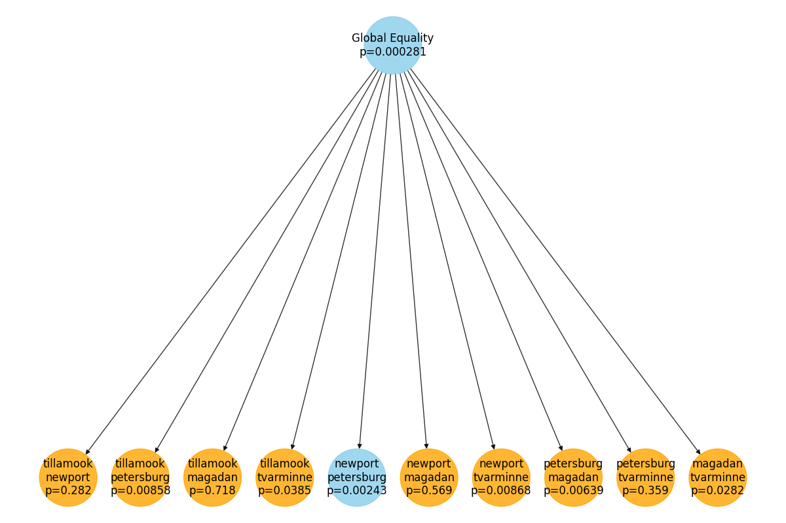

#+CITE_EXPORT: csl ~/Dropbox/org/chicago-author-date-16th-edition.csl
* Testing Statistical Hypotheses in a Tree-Like Hierarchy

This library implements a method for controlling the Familywise Error
Rate (FWER) in a set of statistical hypothesis tests arranged in a
tree-like hierarchy. We are currently writing a paper that proves our
method controls the Familywise Error Rate.
